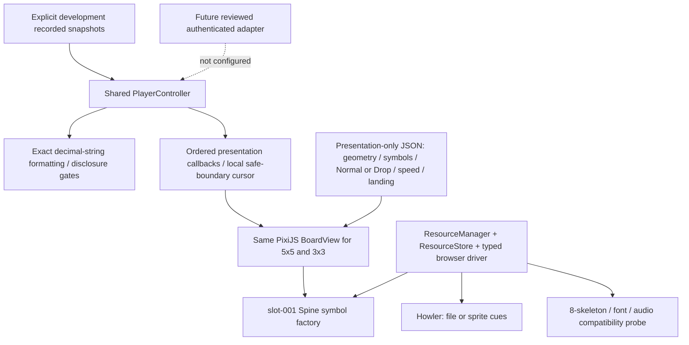

# fw-pixi M1 architecture

The new TypeScript controller is independent of both the supplied JavaScript controller and the previous local mock backend. The shared board/resource/audio implementation is adapted from the existing fw-pixi work. It includes no rules evaluator, RNG weights, mock server, wallet implementation, authenticated endpoint or production fallback. Board motion cycles decorative symbols deterministically; results and displayed money are input records.

The controller validates identity, configuration version, monotonic revision and immutable contiguous released prefixes. It retains null as unknown, hides final amount and balance while payout is unconfirmed, and records a local presentation checkpoint only after the callback completes. That local cursor is not a server ACK. Exact strings are formatted without floating point. Final accepted Spin permission, Play-Token mapping, idempotency and server expiry remain adapter/backend responsibilities under joint review.

BoardView owns Normal/Drop motion, land/idle/win states, viewport/masks and highlights. `PlayerController`, `BoardView`, `ResourceManager` and game probes each have explicit disposal. Resource references are owned and unloaded on final release; pagehide disposes the controller, renderer, audio/probe and resources. Runtime config contains no bets, charges, paytable or payout authority.

Only `mock.html` imports `dev/recorded-source.ts` or the asset probe. Vite copies only the explicit game asset inventory for mock builds; it does not recursively collect the repository. Production builds export the core separately and refuse development content in the artifact verifier. Existing seed build scripts/allowlists are unchanged.
